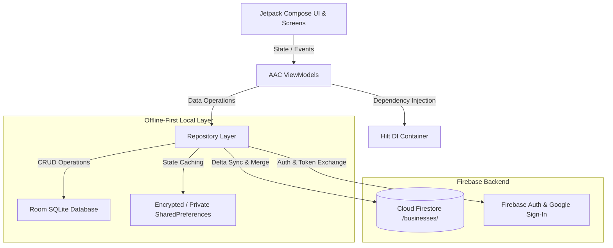

# 📱 MyChemist POS — Mobile Client (Android)

<p align="center">
  
</p>

<p align="center">
  <strong>Modern, Offline-First Pharmacy Point-of-Sale & Floor Inventory Management App</strong>
</p>

<p align="center">
  
  
  
  
  
</p>

---

## 📖 Overview

**MyChemist POS Mobile** is an enterprise-grade, offline-first Android application designed for community pharmacies and medical retailers. Built natively using **Modern Android Development (MAD)** practices—including **Jetpack Compose**, **Kotlin Coroutines & Flow**, **Room SQLite**, and **Hilt Dependency Injection**—the app delivers real-time floor stock management, instant counter checkout, and seamless cloud synchronization with the desktop management client.

---

## 🌟 Key Engineering Features

### 🔄 1. Offline-First Architecture & Delta Sync
- **Local SQLite Persistence:** Complete offline capability via Room DAO architecture. Sales, customer adjustments, and stock levels operate with zero network latency.
- **Timestamp Cursor Delta Sync:** Replaces heavy full-collection downloads with cursor queries (`whereGreaterThan("updatedAt", lastSync)`), reducing Firebase cloud read costs and bandwidth by **over 90%**.
- **Data Preservation Merge Serialization:** Serializes and syncs mobile records using atomic `SetOptions.merge()`, ensuring desktop-specific fields (e.g., KRA compliance codes, bulk supplier barcodes) are never overwritten.

### 🛡️ 2. Device-Bound Software Licensing Gate
- **Key-Pair Entitlement System:** Restricts activation via platform-specific key prefixes (`CHEM-MOB-XXXX-XXXX-XXXX`).
- **Device Seat Enforcement:** Automatically generates and tracks persistent hardware installation IDs (UUID) against allocated license seats (`maxMobileDevices`).
- **7-Day Offline Grace Period:** Allows checkout operations to proceed uninterrupted during network outages with automated silent re-validation once connectivity restores.

### ⚡ 3. Real-Time POS Register & Stock Batching
- **Optimized Checkout Pipeline:** Leverages Firestore atomic batch writes (`firestore.batch()`) paired with in-memory model copying, eliminating 50% of redundant Room database reads during checkout.
- **Dynamic Profit Margins:** Real-time calculation of markup percentage and profit margins with clinical visual indicators.
- **Fast Medicine Lookups:** Quick-select unit tags (`pcs`, `tabs`, `caps`, `ml`, `vials`), expiry date shortcuts (`+6M`, `+1Y`), and categorized photo presets.
- **KES Currency & Multi-Payment Support:** Optimized for the Kenyan market with Cash, M-Pesa STK push reconciliation, and credit/invoice management.

---

## 🏗️ Architecture & Technology Stack



### 🛠️ Tech Stack Details

| Layer | Technologies & Libraries |
| :--- | :--- |
| **Language** | Kotlin 2.0+ |
| **UI Framework** | Jetpack Compose, Material 3, Accompanist |
| **Architecture** | MVVM, Clean Architecture, Repository Pattern |
| **Dependency Injection** | Dagger Hilt 2.50+ |
| **Asynchronous & Reactive** | Kotlin Coroutines, StateFlow, SharedFlow |
| **Local Database** | Room (SQLite with Type Converters & Transactions) |
| **Cloud & Backend** | Firebase Firestore, Firebase Authentication, Android Credential Manager |
| **Analytics & Visualization** | Vico Charts, Coil (Image Loading), Shimmer Compose |

---

## 📂 Project Structure

```
com.habit.mychemistpos/
├── data/
│   ├── local/              # Room Database, DAOs, Entity Models, Converters
│   ├── model/              # Domain models (Product, Sale, Customer, Expense, User)
│   └── repository/         # Repository interfaces & Room/Firebase implementations
├── di/                     # Hilt Modules (FirebaseModule, RepositoryModule)
├── ui/
│   ├── components/         # Reusable Compose Components (Cards, Buttons, Pickers)
│   ├── navigation/         # NavGraph, Route Definitions, Bottom Navigation Bar
│   ├── screens/            # Screen composables (POS, Inventory, Reports, Settings, Auth)
│   └── theme/              # Color palette (Sky Blue / Slate), Typography, Dimens
├── util/                   # Date parsers, sync mappers, currency formatters
└── viewmodel/              # StateFlow-driven ViewModels (POS, Inventory, License, Auth)
```

---

## 🚀 Getting Started

### Prerequisites
- **Android Studio** Hedgehog / Ladybug or newer
- **JDK 17+**
- Android SDK 26 (Android 8.0) minimum, targeting SDK 36

### Build & Run
1. Clone the repository:
   ```bash
   git clone https://github.com/your-username/MyChemistPOS-Mobile.git
   cd MyChemistPOS-Mobile
   ```
2. Open the project in **Android Studio**.
3. Place your `google-services.json` inside the `app/` directory (if configuring your own Firebase tenant).
4. Sync Gradle and run the `:app` module on a physical device or emulator.

---

## 📄 License & Attribution

Developed by **Christian Cheruiyot** as part of the **MyChemist POS** multi-platform pharmacy management ecosystem.
Licensed under the [MIT License](LICENSE).
